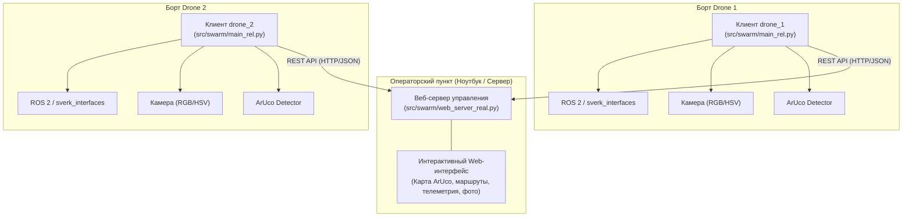

# Управление роем БПЛА: Автономный поиск и картографирование объектов

Репозиторий содержит программный комплекс для автономного выполнения миссий роем беспилотных летательных аппаратов (БПЛА) на платформе **«СВЕРХ»** в рамках образовательного интенсива **ТГУ**.

Комплекс решает задачу скоординированного мониторинга полигона с ArUco-навигацией, автоматического деления зоны поиска между несколькими дронами, детекции цветных наземных маркеров методами компьютерного зрения, расчёта их глобальных координат и передачи телеметрии и фотофиксации на центральный пункт управления.

---

## 📌 Содержание

- [Архитектура проекта](#-архитектура-проекта)
- [Структура репозитория](#-структура-репозитория)
- [Режимы работы](#-режимы-работы)
  - [1. Симулятор (src/simulator)](#1-модуль-симулятора-srcsimulator)
  - [2. Реальный полёт роя (src/swarm)](#2-модуль-реального-полёта-роя-srcswarm)
- [Алгоритмы и технические решения](#-алгоритмы-и-технические-решения)
  - [Компьютерное зрение и детекция объектов](#компьютерное-зрение-и-детекция-объектов)
  - [Геопривязка и расчёт координат](#геопривязка-и-расчёт-координат)
  - [Планирование маршрутов и балансировка (TSP)](#планирование-маршрутов-и-балансировка-tsp)
  - [Решение проблемы QoS в ROS 2](#решение-проблемы-qos-в-ros-2)
- [Центральный веб-сервер и API](#-центральный-веб-сервер-и-api)
- [Установка и запуск](#-установка-и-запуск)
  - [Симуляция](#запуск-в-симуляторе)
  - [Реальный полигон](#запуск-на-реальном-полигоне)

---

## 🏗 Архитектура проекта

Система построена по распределённой клиент-серверной архитектуре с интеграцией стека **ROS 2** и фреймворка **`sverk_interfaces`**:



---

## 📂 Структура репозитория

```text
├── README.md                     # Документация проекта
├── .gitignore                    # Исключения версионного контроля
└── src/
    ├── simulator/                # Модуль автономной работы в среде симулятора
    │   ├── main.py               # Основное решение: 2 дрона, разбиение 2+3 ряда, ArUco-калибровка
    │   └── code.py               # Альтернативный алгоритм облёта челночной траекторией (lawnmower)
    └── swarm/                    # Модуль для реального роевого полёта на полигоне
        ├── web_server_real.py    # Центральный диспетчерский сервер с Web GUI и планировщиком
        └── main_rel.py           # Бортовой скрипт автономного агента дрона (drone_1 / drone_2)
```

---

## 🚀 Режимы работы

### 1. Модуль симулятора (`src/simulator`)

Решение оптимизировано под симуляционную среду полигона ТГУ с ArUco-покрытием ID `0..24` (сетка 5×5 с шагом 0.8 м от `-1.6` до `+1.6` м).

- [`src/simulator/main.py`](file:///Users/vierret/programming/sverk_education_intensive_tsu/src/simulator/main.py):
  - **Синхронный запуск:** Инициализация `drone_1` и `drone_2` с контролем общего временного бюджета миссии (таймаут взлёта и поиска: 94 сек, общий лимит: 118 сек).
  - **Траектория 2 + 3:** Динамическое разделение координатной сетки по оси `Y` — один дрон берёт 2 нижних ряда (`[-1.6, -0.8]`), второй дрон — 3 верхних ряда (`[0.0, 0.8, 1.6]`) с учётом близости стартовых позиций.
  - **Коррекция по ArUco:** При попадании в кадр меток ArUco решается задача линейных наименьших квадратов (`np.linalg.lstsq`) для компенсации ошибок угла рыскания (`yaw`) и дрейфа координат.
  - **Цвета объектов:** Красный, Жёлтый, Зелёный.
- [`src/simulator/code.py`](file:///Users/vierret/programming/sverk_education_intensive_tsu/src/simulator/code.py):
  - Модель челночного сканирования половин поля с разделением по `Y = 0` и фильтрацией кадровых дубликатов по хэшу изображения.

### 2. Модуль реального полёта роя (`src/swarm`)

Полнофункциональный комплекс управления роем для работы на физическом полигоне с метками ArUco ID `25..49` (сетка 5×5, координаты от `-2` до `+2` м).

- [`src/swarm/web_server_real.py`](file:///Users/vierret/programming/sverk_education_intensive_tsu/src/swarm/web_server_real.py):
  - **Интерактивный дашборд:** Отображение статуса дронов, текущей телеметрии, сетки меток и найденных объектов в реальном времени.
  - **Исключение неисправных меток:** Возможность кликом исключить повреждённые или недоступные метки из плана полёта.
  - **Выбор стратегии разделения:** Разделение по оси `Y` (вдоль) или по оси `X` (поперёк) с автоматической балансировкой нагрузки (выравнивание количества точек между бортами).
  - **Оптимизация путей (TSP):** Сортировка путевых точек методом ближайшего соседа для минимизации общего времени перелёта.
  - **Управление фазами миссии:** Строгая последовательность: `Подключение` → `Взлёт` → `Локализация старта` → `Генерация и подтверждение маршрутов` → `Старт миссии` → `Посадка` → `Итоговый отчёт`.
  - **Галерея находок:** Приём снимков (`crop`), их сохранение в папку `static/captures/` и мгновенный вывод в веб-интерфейсе.
- [`src/swarm/main_rel.py`](file:///Users/vierret/programming/sverk_education_intensive_tsu/src/swarm/main_rel.py):
  - **Жизненный цикл дрона:** Автономный сценарий взлёта, ожидания команд, облёта и возврата.
  - **Устойчивая цветовая классификация:** Использование цветового пространства HSV, устойчивого к перепадам естественного освещения зала.
  - **Цвета объектов:** Красный, Жёлтый, Синий.
  - **Подтверждение детекции:** Фильтрация артефактов и теней — объект регистрируется только при стабильном обнаружении минимум на 3 независимых кадрах (`n >= 3`).

---

## 🧠 Алгоритмы и технические решения

### Компьютерное зрение и детекция объектов

1. **Цветовая сегментация (HSV):**
   - **Красный:** Объединение двух пороговых диапазонов для обработки кругового перекрытия шкалы Hue ($[0, 10] \cup [160, 180]$).
   - **Жёлтый:** Диапазон $H \in [20, 35]$.
   - **Синий:** Диапазон $H \in [100, 130]$.
2. **Фильтрация шумов:**
   - Поиск связных компонент (`connectedComponentsWithStats` или кастомный обход на половинном разрешении для ускорения).
   - Отсечение по площади пятна, соотношению сторон (квадратность/округлость) и заполнению описанного прямоугольника (`solidity > 0.55`).
   - Исключение объектов на границах кадра для предотвращения краевых геометрических искажений.

### Геопривязка и расчёт координат

Пересчёт пиксельных координат центра объекта $(u, v)$ в глобальную систему координат полигона (`aruco_map` / `map`):

$$f = \frac{W}{2 \cdot \tan(\text{FOV} / 2)}$$

$$\Delta x_{body} = -\frac{v - H/2}{f} \cdot z, \quad \Delta y_{body} = -\frac{u - W/2}{f} \cdot z$$

$$\begin{pmatrix} x_{world} \\ y_{world} \end{pmatrix} = \begin{pmatrix} x_{drone} \\ y_{drone} \end{pmatrix} + \begin{pmatrix} \cos(\psi) & -\sin(\psi) \\ \sin(\psi) & \cos(\psi) \end{pmatrix} \begin{pmatrix} \Delta x_{body} \\ \Delta y_{body} \end{pmatrix}$$

где:
- $W, H$ — ширина и высота кадра камеры;
- $\text{FOV} = 65^\circ$ — угол обзора камеры;
- $z$ — текущая высота по альтиметру/дальномеру;
- $\psi$ — угол рыскания (`yaw`).

При видимости нескольких меток ArUco в симуляторе применяется прямое аффинное преобразование с уточнением методом МНК, что нивелирует ошибки ориентации БПЛА.

### Планирование маршрутов и балансировка (TSP)

1. Поле делится выбранной осевой плоскостью (`X` или `Y`).
2. Точки на границе разделения распределяются к ближайшему дрону по расстоянию до его точки взлёта.
3. Разница в количестве точек между дронами балансируется переносом пограничных меток ($\le 2$ точек).
4. Маршрут каждого борта оптимизируется жадным алгоритмом поиска ближайшего соседа (TSP Heuristic) со стартом от начальной метки дрона.

### Решение проблемы QoS в ROS 2

В реальных условиях стандартная обёртка подписки на топик `/aruco/det/markers` из `sverk_interfaces` может приводить к потере пакетов из-за несовпадения политик качества обслуживания (QoS mismatch).

В [`src/swarm/main_rel.py`](file:///Users/vierret/programming/sverk_education_intensive_tsu/src/swarm/main_rel.py#L176-L220) создаётся независимая ROS 2 нода с профилем `BEST_EFFORT`:

```python
marker_qos = QoSProfile(
    reliability=ReliabilityPolicy.BEST_EFFORT,
    history=HistoryPolicy.KEEP_LAST,
    depth=1
)
sub = node.create_subscription(MarkerArray, '/aruco/det/markers', marker_callback, marker_qos)
```
Это гарантирует стабильное определение стартовой метки дрона сразу после взлёта.

---

## 🌐 Центральный веб-сервер и API

Веб-сервер запускается на хосте оператора (по умолчанию порт `8000`) и реализует следующий REST API:

| Метод | Эндпоинт | Описание |
| :--- | :--- | :--- |
| `GET` | `/` | Интерактивная веб-панель оператора |
| `GET` | `/api/state` | Полное состояние миссии, дронов и карты |
| `POST` | `/api/toggle_marker` | Исключить / вернуть метку по её ID |
| `POST` | `/api/set_axis` | Установить ось разделения поля (`"x"` или `"y"`) |
| `POST` | `/api/send_takeoff` | Перевести миссию в статус взлёта дронов |
| `POST` | `/api/send_route` | Дать сигнал на начало облёта по сформированным путям |
| `POST` | `/api/reset` | Полный сброс параметров в исходное состояние |
| `POST` | `/api/drone/<id>/online` | Регистрация дрона в сети |
| `POST` | `/api/drone/<id>/report_start` | Отправка дроном распознанной стартовой метки |
| `GET` | `/api/drone/<id>/get_route` | Запрос персонального маршрута бортом |
| `POST` | `/api/drone/<id>/accept_route` | Подтверждение приёма маршрута дроном |
| `POST` | `/api/drone/<id>/report_item` | Загрузка найденного объекта (координаты, цвет, base64-снимок) |
| `POST` | `/api/drone/<id>/report_finish` | Передача итоговой статистики по цветам |
| `POST` | `/api/drone/<id>/telemetry` | Обновление телеметрии и текстового статуса дрона |

---

## 🛠 Установка и запуск

### Требования к окружению

- **ОС:** Ubuntu 22.04 LTS / ROS 2 (Humble)
- **Python:** 3.10+
- **Зависимости:**
  - `numpy`, `opencv-python`, `opencv-contrib-python`
  - Пакеты `sverk_interfaces`, `aruco_det_loc`, `rclpy`

---

### Запуск в симуляторе

Для автономного запуска сканирования двумя дронами в среде симулятора:

```bash
python3 src/simulator/main.py
```

Альтернативный запуск челночного сканирования:
```bash
python3 src/simulator/code.py
```

---

### Запуск на реальном полигоне

#### Шаг 1: Запуск сервера управления (Ноутбук оператора)

Убедитесь, что ноутбук находится в одной локальной Wi-Fi сети с дронами (например, `192.168.1.76`):

```bash
python3 src/swarm/web_server_real.py
```
Откройте браузер по адресу: `http://localhost:8000`.

#### Шаг 2: Запуск клиентов на бортах БПЛА

Задайте переменной окружения адрес управляющего сервера:

**На борту Drone 1:**
```bash
export MISSION_SERVER_URL="http://192.168.1.76:8000"
python3 src/swarm/main_rel.py drone_1
```

**На борту Drone 2:**
```bash
export MISSION_SERVER_URL="http://192.168.1.76:8000"
python3 src/swarm/main_rel.py drone_2
```

#### Шаг 3: Проведение миссии через веб-интерфейс

1. В веб-панели убедитесь, что оба дрона перешли в статус **«В сети»**.
2. При необходимости кликните по неисправным меткам на карте ArUco, чтобы исключить их из маршрутов.
3. Выберите ось разделения полигона: **↕️ По оси Y** или **↔️ По оси X**.
4. Нажмите **«🛫 Отправить команду взлёта»**. Дроны взлетят и считают свои стартовые метки.
5. Сервер рассчитает оптимальные маршруты. После подтверждения дронами кнопка **«📤 Отправить путь»** станет активной.
6. Нажмите **«📤 Отправить путь»**. Дроны автономно выполнят облёт, в реальном времени передавая координаты и фотоснимки найденных объектов.
7. По завершении облёта дроны выполнят мягкую посадку и передадут суммарные результаты.
